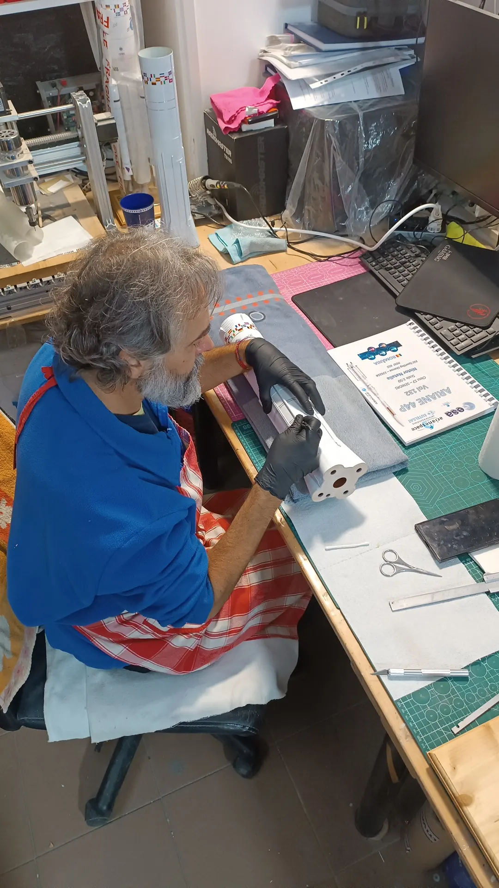

# ✈️ NOVA Tech Models — Atelierul & Academia de Aeromodelism și Rachetomodelism

[-LIVE%20ON%20GITHUB%20PAGES-c85a17?style=for-the-badge&logo=github)](https://lefterpatrickandrei-sketch.github.io/nova-tech-models/v2/)
[-LIVE%20ON%20GITHUB%20PAGES-00e5ff?style=for-the-badge&logo=github)](https://lefterpatrickandrei-sketch.github.io/nova-tech-models/)
[](https://lefterpatrickandrei-sketch.github.io/nova-tech-models/v2/)

> **Atelier de Inginerie la Scară, Aeromodelism, Rachetomodele Clasa FAI S7 și Planșotecă 1:1**  
> 🚀 **Varianta 2 (Nouă — Editorial Aerospace Atelier):** **[https://lefterpatrickandrei-sketch.github.io/nova-tech-models/v2/](https://lefterpatrickandrei-sketch.github.io/nova-tech-models/v2/)**  
> 🌐 **Varianta 1 (Arhivă Inițială):** **[https://lefterpatrickandrei-sketch.github.io/nova-tech-models/](https://lefterpatrickandrei-sketch.github.io/nova-tech-models/)**  
> ✉️ **Contact Atelier:** `contact@novatechmodels.ro`

---

<p align="center">
  
</p>

> 🎨 **Studio & Arhivă Logo-uri (6 Concepte SVG 100/100 + Kit Producție):** **[Deschide Studioul de Logo-uri Live (`v2/logos/`)](https://lefterpatrickandrei-sketch.github.io/nova-tech-models/v2/logos/)**



---

## 🏛️ Despre Platformă — Varianta 2 (`/v2/`)

**Varianta 2 (`/v2/`)** reprezintă reconstrucția completă a platformei web sub forma unui **Atelier Editorial Aerospațial**, dedicat școlii românești de aeromodelism și rachetomodelism de performanță (coordonare tehnică **Maestru Cornel Nistor** și corpusul teoretic al **Prof. Florin G. Ursa** — *Palatul Copiilor Târgu Mureș*). Toate resursele (planșe 1:1, sinteze de curs, diagrame și galerii) sunt integrate direct și autonom în aplicație.

### ✨ Secțiuni și Module Interactive în `v2/`

1. **Comparatorul X-Ray Interactiv (`#filozofie`, `#sectiune-xray`)**
   - Inspecție interactivă *Înainte / După* (structură de rezistență din lemn de balsa vs. fuselaj împânzit și vopsit sau plan de execuție) pentru **3 proiecte de referință**:
     - **Fokker D.VII** — Schelet balsa & nervuri vs. model împânzit *Lozenge*
     - **Sopwith F.1 Camel** — Structură de rezistență vs. planșă tehnică pe hârtie de calc
     - **Ariane 44P (Clasa FAI S7)** — Structură albă în lucru pe banc vs. perechea *Eutelsat* finisată pentru concurs
2. **Programa Oficială în 4 Etape și 12 Trepte de Calificare (`#programa`, `#parcurs`)**
   - Sistem complet de pregătire structurat pe **4 etape × 3 niveluri**:
     - **Etapa I — Basic (`B1`, `B2`, `B3`)**: Inițiere în geometria aripii și zbor liber (`YR-O.Z.N.`, `YR-Delta`, `YR-Șoim`, `YR-Sport`, `Felix 5`)
     - **Etapa II — Mediu (`M1`, `M2`, `M3`)**: Structuri portante, lonjeroane, împânzire termocontractibilă și propulsie cu motor de cauciuc (`YR-Albatros`, `YR-5 Ciocîrlia`, `Planor Faza II`, `Libelula`)
     - **Etapa III — Specialist (`S1`, `S2`, `S3`)**: Machete statice și zburătoare la scară WWI/WWII și debitare CNC (`Sopwith Pup`, `Fokker Dr.I`, `Junkers D-1`, `Sopwith Camel`, `Fokker D.VII`, `Fw 190 A`)
     - **Etapa IV — Profesionist (`P1`, `P2`, `P3`)**: Rachetomodele la scară **Clasa FAI S7** și lot național (`Ariane 44P`, `Ariane 5`, `Saturn V`, `Saturn IB`, `Soyuz`, `N1`, `Vostok`)
   - Include un **Diagnostic Interactiv în 3 parametri** care recomandă automat treapta de intrare și primul proiect de atelier.
3. **Planșoteca Atelierului la Scară 1:1 (`#plansoteca`)**
   - **16 planșe de execuție și diagrame de curs** filtrabile pe etape (`B1` → `P3`), cu inspecție la rezoluție înaltă în fereastră modală nativă `<dialog>` și descărcare directă.
4. **Expoziția FAI & Galeria Lotului (`#galerie`)**
   - **24 exponate documentate** împărțite în 3 colecții filtrabile (*Rachetomodele S7*, *Aeromodele & Biplane*, *Viața de Atelier & CNC*), însoțite de fișe tehnice complete (scară, clasă FAI, materiale și palmares).
5. **Laboratorul de Calcule & Simulatoare Live cu SVG Dinamic (`#laborator`)**
   - **Simulator 1 — Aerodinamică & Profil Coordonate (11 Stații)**: Calcul de portanță $L$, rezistență la înaintare $D$, viteză de înfundare și trasare SVG în timp real a profilului aerodinamic cu tabelul celor 11 stații ($0\% - 100\%$ coardă).
   - **Simulator 2 — Rachetomodele & Stabilitate Barrowman ($CP$ vs. $CG$)**: Calculul rezervei statice de stabilitate în calibre ($1{,}5 - 2{,}5\text{ cal.}$) cu randare SVG dinamică a rachetei și poziționarea live a centrului de greutate ($CG$) și a centrului de presiune ($CP$).
   - **Simulator 3 — Jurizare Oficială FAI Clasa S7 & Telemetrie Dublu-Teodolit**: Simulator de punctaj conform regulamentului FAI (400p stand + 100p zbor = 500p) și calcul trigonometric al altitudinii de apogeu pe bază de telemetrie optică ($b = 300\text{ m}$).
6. **Enciclopedia de Curs — 1.017 Pagini & Glosar Tehnic (`#tratate`)**
   - Cititor interactiv structurat pe cele **3 volume de curs** (*Vol. I Începători* — 148 pagini, *Vol. II Avansați* — 275 pagini, *Vol. III Performanță* — 594 pagini) și motor de căutare instantanee în glosarul tehnic de atelier.

---

## 📂 Structura Repository-ului

```text
nova-tech-models/
├── index.html          # Varianta 1 (Platforma inițială — păstrată intactă)
├── styles.css          # Stilurile Variantei 1
├── app.js              # Logica interactivă a Variantei 1
├── assets/             # Resursele grafice ale Variantei 1
└── v2/                 # Varianta 2 — Editorial Aerospace Atelier (Reconstruită de la zero)
    ├── index.html      # Arhitectura semantică HTML5 + SVG + Schema.org (7 secțiuni interactive)
    ├── styles.css      # Design system OKLCH, temă Light/Dark ("Hârtie de Calc" / "Telemetrie Nocturnă")
    ├── app.js          # Simulatoare SVG live, X-Ray comparator, Planșotecă, Cititor 3 volume, Glosar
    └── assets/
        └── img/        # 82 fișiere WebP optimizate (41 perechi -800.webp și -1600.webp)
```

---

## 🛠️ Tehnologii & Standarde de Calitate

- **HTML5 Semantic & Nativ**: `<dialog>` nativ cu gestionare completă a focusului, `aria-live`, tabele de coordonate și diagrame vectoriale SVG dinamice.
- **CSS Modern (OKLCH & Fluid Typography)**: 81 variabile CSS, temă duală cu persistență în `localStorage`, `clamp()` tipografic (`Instrument Serif`, `Plus Jakarta Sans`, `JetBrains Mono`), *spotlight cards* și suport complet `prefers-reduced-motion`.
- **Zero Dependențe Externe JS**: Vanilla JavaScript modular, fără framework-uri grele, scor **100/100 (Grade A+)** la auditul de performanță, accesibilitate și prevenire CLS (`width`/`height` explicite pe toate imaginile).

---

## 🚀 Rulare Locală

Poți deschide proiectul local cu orice server HTTP static din rădăcina repository-ului:

```bash
python -m http.server 8080
```

- **Varianta 2 (Nouă):** `http://localhost:8080/v2/`
- **Varianta 1 (Clasic):** `http://localhost:8080/`

---

## 📄 Licență & Credite

© 2026 **NOVA Tech Models** — Atelierul de Modelism & Inginerie Aerospațială la Scară.  
Materiale didactice și documentație tehnică: **Maestru Cornel Nistor** & **Prof. Florin G. Ursa**. Toate drepturile rezervate.
